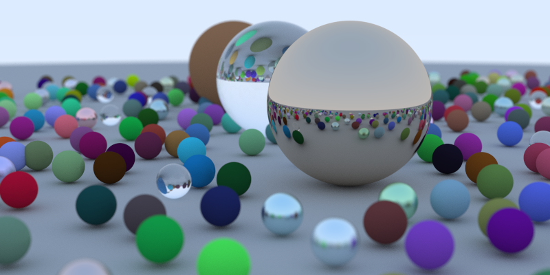

# GPU Raytracer

A compute shader raytracer written in Rust, compiled to SPIR-V with [rust-gpu](https://github.com/Rust-GPU/rust-gpu) and run through [wgpu](https://github.com/gfx-rs/wgpu). It follows [Ray Tracing in One Weekend](https://raytracing.github.io/books/RayTracingInOneWeekend.html).

## Showcase



## Building and running

```sh
cargo run --release
```

This writes `image.ppm` to the working directory.
